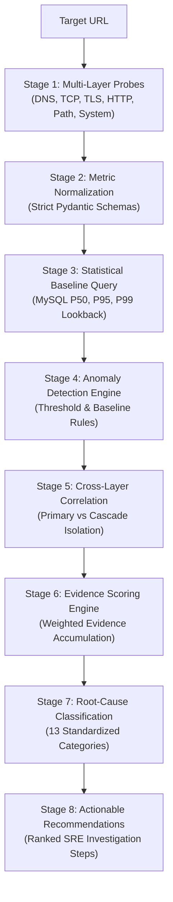
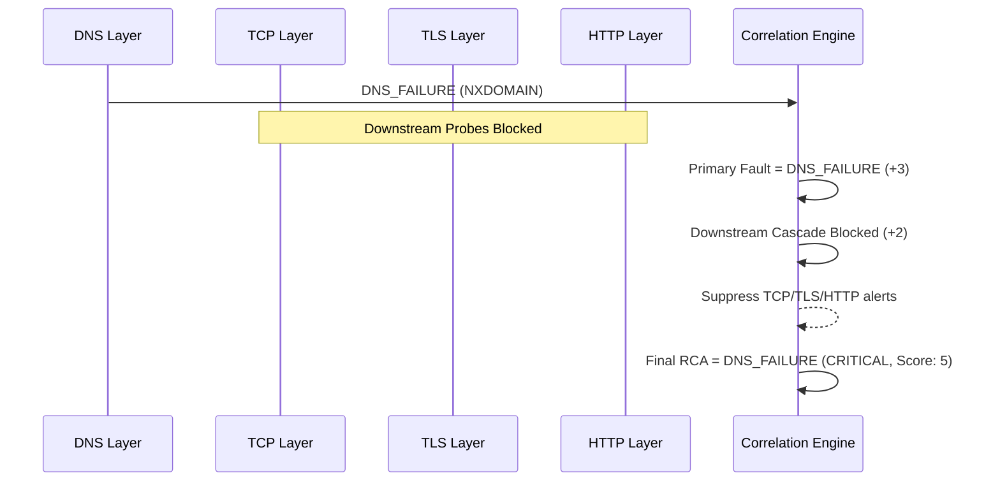

# NetPath — Evidence Scoring & Deterministic Root-Cause Methodology

> **Specification & Formal Methodology Document**  
> *Author: NetPath Architecture Team*  
> *Platform: NetPath Deterministic Network Path Analysis & Root-Cause Diagnosis Platform*  
> *Version: 1.0.0*

---

## 1. Executive Summary & Core Philosophy

In production distributed systems, performance degradation and outages rarely manifest as isolated, unambiguous events. A slow database query manifests upstream as elevated HTTP latency; an upstream microservice crash manifests at the edge as an HTTP 502 Bad Gateway; an invalid DNS record cascades into TCP connection timeouts, TLS handshake failures, and client aborts.

Traditional observability tools fail operators in two fundamental ways:
1. **Symptom Alert Storms**: Simple threshold alerting fires simultaneous alarms across HTTP, TCP, and application layers, leaving operators to manually reconstruct causality under high stress.
2. **Non-Deterministic / Black-Box "AI" Hallucinations**: Large Language Models (LLMs) and black-box classifiers introduce probabilistic uncertainty, non-reproducible diagnoses, and hallucinated root causes into mission-critical triage.

### The NetPath Guarantee: 100% Deterministic & Explainable Root-Cause Analysis
NetPath replaces guesswork with an **explainable, deterministic evidence scoring engine**. 

```
Collectors (Probes)
       ↓
Normalized Metrics Schema
       ↓
Historical Baselines (P50, P95, P99)
       ↓
Deterministic Anomaly Detection
       ↓
Cross-Layer Correlation Engine (Cascade Suppression)
       ↓
Evidence Scoring Accumulator
       ↓
Root-Cause Diagnosis & Actionable Remediation
```

Every diagnosis generated by NetPath satisfies three non-negotiable guarantees:
* **Zero Probabilistic Hallucination**: No LLM participates in determining the root cause or severity.
* **Full Auditability**: Every diagnosis is backed by an itemized list of weighted evidence items ($\sum w_i$) linking raw probe measurements against historical percentiles.
* **Deterministic Reproducibility**: Given identical probe results and historical baseline distributions, NetPath will produce the exact same diagnosis, evidence score, severity, and recommendations every single time.

---

## 2. Complete Evidence Lifecycle

The diagnostic evaluation of a target URL (e.g., `https://service.example.com`) traverses eight discrete stages:



---

## 3. Metrics Normalization & Statistical Engine

### 3.1 Collected Telemetry by Layer

| Layer | Collector Component | Primary Metrics | Unit | Nominal Expectation |
| :--- | :--- | :--- | :--- | :--- |
| **DNS** | `DNSCollector` | `latency_ms`, `addresses`, `status` | ms | $< 100\text{ ms}$, resolved $\ge 1\text{ IP}$ |
| **TCP** | `TCPCollector` | `connect_latency_ms`, `destination_ip`, `status` | ms | $< 50\text{ ms}$, SYN-ACK established |
| **TLS** | `TLSCollector` | `handshake_latency_ms`, `days_to_expiration`, `is_valid` | ms / days | Valid cert, $> 30\text{ days}$, $< 100\text{ ms}$ |
| **HTTP** | `HTTPCollector` | `status_code`, `ttfb_ms`, `total_latency_ms`, `bytes` | code / ms | HTTP 200, $\text{TTFB} < 500\text{ ms}$, $< 1000\text{ ms}$ |
| **Network** | `NetworkPathCollector` | `hop_number`, `rtt_ms`, `packet_loss_pct`, `timeouts` | count / % | $0\%\text{ packet loss}$, stable hop RTTs |
| **System** | `LinuxMetricsCollector`| `cpu_pct`, `memory_pct`, `net_errin`, `net_dropin` | % / count | $< 85\%\text{ CPU/Mem}$, $0\text{ drops/errors}$ |

---

### 3.2 Historical Baseline Distribution Formulation

NetPath stores timestamped metric samples in MySQL (`metric_samples`). For each target and metric, the baseline engine calculates parametric and non-parametric statistical distributions over a rolling lookback window of $N$ samples (default $N = 100$):

$$\text{Count } (n), \quad \text{Min } (x_{(1)}), \quad \text{Max } (x_{(n)}), \quad \text{Mean } (\mu), \quad \text{Median } (\tilde{x}), \quad \text{StdDev } (\sigma)$$

#### Percentile Calculation ($P_{50}, P_{95}, P_{99}$)
Percentiles are evaluated using linear interpolation over rank-ordered sample arrays:

$$k = (n - 1) \cdot p$$
$$f = \lfloor k \rfloor, \quad c = \lceil k \rceil$$
$$P_p = x_{(f)} \cdot (c - k) + x_{(c)} \cdot (k - f)$$

Where $p \in \{0.50, 0.95, 0.99\}$.

#### The Minimum Evidence Safeguard ($N < 10$)
To prevent false-positive anomaly alerts on newly provisioned targets:

$$\text{is\_sufficient\_evidence} = \begin{cases} \text{True} & \text{if } n \ge 10 \\ \text{False} & \text{if } n < 10 \end{cases}$$

If $n < 10$, baseline deviation checks (such as $latency > P_{95}$) are **inhibited**. The engine reports `INSUFFICIENT_EVIDENCE` (or defaults to static safety thresholds), ensuring that early measurements never trigger spurious high-severity alerts.

---

## 4. Deterministic Anomaly Detection Rules

The `AnomalyEngine` evaluates collected telemetry against static engineering thresholds and historical baselines:

| Rule Identifier | Trigger Condition | Anomaly Severity | Evidence Output |
| :--- | :--- | :--- | :--- |
| `DNS_RESOLUTION_FAILURE` | `dns_status == 'DNS_FAILURE'` | `CRITICAL` | Target hostname resolution failed (NXDOMAIN / timeout). |
| `DNS_BASELINE_P95_EXCEEDED`| `dns_latency_ms > baseline.P95` ($n \ge 10$) | `HIGH` | DNS latency exceeds historical 95th percentile. |
| `DNS_THRESHOLD_EXCEEDED` | `dns_latency_ms > 300.0` (static) | `MEDIUM` | DNS resolution latency exceeds static threshold. |
| `TCP_CONNECTIVITY_FAILURE` | `tcp_status == 'TCP_CONNECTIVITY_FAILURE'` | `CRITICAL` | TCP 3-way handshake failed (refused, port closed, timeout). |
| `TCP_BASELINE_P95_EXCEEDED`| `connect_latency_ms > baseline.P95` ($n \ge 10$) | `HIGH` | TCP connection latency exceeds historical 95th percentile. |
| `TLS_HANDSHAKE_FAILURE` | `tls_status == 'TLS_FAILURE'` | `CRITICAL` | TLS negotiation failed (certificate invalid, expired, mismatch). |
| `TLS_CERTIFICATE_EXPIRING` | `days_to_expiration < 30` | `HIGH` | Certificate expires within 30 days. |
| `TLS_BASELINE_P95_EXCEEDED`| `handshake_latency_ms > baseline.P95` | `MEDIUM` | TLS handshake latency exceeds historical 95th percentile. |
| `HTTP_SERVER_ERROR` | `http_status_code >= 500` | `CRITICAL` | Server returned application 5xx error code. |
| `HTTP_CLIENT_RESOURCE_ERROR` | `http_status_code in (404, 429)` | `HIGH` / `MEDIUM` | Server returned 404 Not Found or 429 Rate Limited. |
| `HTTP_BASELINE_P95_EXCEEDED`| `http_latency_ms > baseline.P95` ($n \ge 10$) | `HIGH` | HTTP total latency exceeds historical 95th percentile. |
| `HTTP_LATENCY_THRESHOLD_EXCEEDED` | `http_latency_ms > 1000.0` (static) | `MEDIUM` | HTTP latency exceeds 1,000ms static threshold. |
| `NETWORK_TOTAL_PACKET_LOSS` | All intermediate hops timed out | `HIGH` | 100% intermediate transit packet loss. |
| `NETWORK_PARTIAL_PACKET_LOSS`| $> 1$ hop timed out or dropped | `MEDIUM` | Intermediate transit hops exhibited packet loss. |
| `SYSTEM_RESOURCE_PRESSURE` | Local `cpu_pct > 90%` or `memory_pct > 90%` | `HIGH` | Local client host CPU/memory saturation. |
| `INTERFACE_ERRORS_DETECTED` | `net_errin + net_errout > 0` | `HIGH` | Network interface hardware errors or frame drops. |

---

## 5. Cross-Layer Correlation & Cascade Suppression

### The Cascade Problem
In a standard request execution:
$$\text{DNS} \longrightarrow \text{TCP Handshake} \longrightarrow \text{TLS Handshake} \longrightarrow \text{HTTP Application}$$

If DNS resolution fails:
1. TCP cannot open a socket (Destination IP unknown).
2. TLS handshake cannot initiate.
3. HTTP client throws a connection error.

A naive monitoring system generates 4 separate alerts. NetPath's **CorrelationEngine** implements **Dependency Flow Analysis**:



### Cascade Suppression Rules
1. **DNS Failure Dominance**: If DNS fails, TCP, TLS, and HTTP failures are suppressed as primary root causes and consolidated into corroborating cascade evidence (`+2 weight: Downstream TCP and HTTP blocked`).
2. **TCP Connect Failure Dominance**: If TCP connection is refused or times out, TLS and HTTP failures are suppressed. Corroborating evidence notes: `DNS resolution succeeded before TCP failure (+1 weight)`.
3. **Application Latency vs Network Latency Isolation**:
   - If HTTP latency is high, but TCP connect latency and DNS latency are nominal, the issue is isolated to `HTTP_APPLICATION_LATENCY`.
   - If TTFB accounts for $> 70\%$ of total latency, corroborating evidence confirms server-side backend processing time (`+2 weight`).
   - If TCP connect latency and network transit hops are also degraded, the issue is correlated to `NETWORK_LATENCY` or `NETWORK_PACKET_LOSS`.

---

## 6. The Evidence Scoring Mathematical Model

### 6.1 Formula

The overall Evidence Score $S$ for a diagnostic session is the non-negative scalar sum of all weighted primary and corroborating evidence items:

$$S = \max\left(0, \; \sum_{i=1}^{m} w_i\right)$$

Where:
* $w_i \in \mathbb{Z}^+$ represents the deterministic integer weight assigned to evidence item $i$.
* $m$ is the total count of matched primary anomalies and corroborating correlation rules.

---

### 6.2 Evidence Weight Matrix

```
┌────────────────────────────────────────────────────────┬────────┐
│ Evidence Item / Trigger Rule                           │ Weight │
├────────────────────────────────────────────────────────┼────────┤
│ Primary Fatal Network/Application Failures:            │        │
│   • TCP 3-way handshake failed (Refused / Timeout)     │   +4   │
│   • TLS Handshake / Certificate Validation Failure     │   +4   │
│   • HTTP Server 5xx Error (500, 502, 503, 504)         │   +4   │
│   • DNS Resolution Failure (NXDOMAIN / Timeout)        │   +3   │
│   • HTTP Application Latency Spike (> P95)             │   +3   │
│   • Network Path Packet Loss Observed                  │   +3   │
│   • SSL Certificate Expiring (< 30 days)               │   +3   │
│   • HTTP Client Resource Error (404, 429)              │   +3   │
│                                                        │        │
│ Corroborating Multi-Layer Evidence:                    │        │
│   • High TTFB Ratio (> 70% of total latency)           │   +2   │
│   • Lower Network Layers Confirmed Nominal             │   +2   │
│   • Downstream Dependent Layers Blocked by Upstream    │   +2   │
│   • TCP Connect Latency Elevated due to Retransmits    │   +2   │
│   • Historical Baseline P95 Exceeded                   │   +2   │
│   • Local Host Network Interface Drops / Errors        │   +2   │
│   • Local Host CPU / Memory Resource Pressure (> 90%)   │   +2   │
│   • Upstream Layer Completed Normally (DNS/TCP ok)     │   +1   │
│   • Nominal Probe Operation / Baseline Met             │   +1   │
└────────────────────────────────────────────────────────┴────────┘
```

---

### 6.3 Severity Determination Matrix

The severity level of the diagnostic session is mapped deterministically from the root-cause category and evidence score:

```
┌──────────────┬───────────────────┬─────────────────────────────────────────────────────────┐
│ Severity     │ Evidence Score    │ Qualification Criteria                                  │
├──────────────┼───────────────────┼─────────────────────────────────────────────────────────┤
│ CRITICAL     │ Score ≥ 5         │ Hard fatal error: DNS_FAILURE, TCP_CONNECTIVITY_FAILURE,│
│              │                   │ TLS_FAILURE, or HTTP_APPLICATION_ERROR (5xx).           │
├──────────────┼───────────────────┼─────────────────────────────────────────────────────────┤
│ HIGH         │ Score ≥ 5         │ Severe degradation: HTTP_APPLICATION_LATENCY (> P95),   │
│              │                   │ NETWORK_PACKET_LOSS, TLS_CERTIFICATE_EXPIRING,          │
│              │                   │ or NETWORK_INTERFACE_ERRORS.                            │
├──────────────┼───────────────────┼─────────────────────────────────────────────────────────┤
│ MEDIUM       │ 3 ≤ Score < 5     │ Moderate degradation: TCP_DEGRADATION, 404/429 errors,  │
│              │                   │ or RESOURCE_PRESSURE.                                   │
├──────────────┼───────────────────┼─────────────────────────────────────────────────────────┤
│ LOW          │ 1 ≤ Score < 3     │ Minor statistical anomaly without operational impact.   │
├──────────────┼───────────────────┼─────────────────────────────────────────────────────────┤
│ INFO         │ Score = 1         │ All probes succeeded within normal baseline parameters. │
└──────────────┴───────────────────┴─────────────────────────────────────────────────────────┘
```

---

## 7. The 13 Deterministic Root-Cause Categories

Every session resolves into exactly one primary category:

1. **`DNS_FAILURE`**: Target hostname could not be resolved (NXDOMAIN or DNS query timeout).
2. **`DNS_DEGRADATION`**: DNS latency is significantly elevated above baseline, delaying TCP connection.
3. **`TCP_CONNECTIVITY_FAILURE`**: Target port closed, connection refused, or target host unreachable.
4. **`TCP_DEGRADATION`**: TCP 3-way handshake latency elevated (SYN queue saturation or routing delays).
5. **`TLS_FAILURE`**: Certificate invalid, expired, self-signed (untrusted), or cipher mismatch.
6. **`TLS_CERTIFICATE_EXPIRING`**: Certificate is valid but expires within 30 days.
7. **`HTTP_APPLICATION_ERROR`**: Upstream server returned HTTP 500, 502, 503, 504, 404, or 429.
8. **`HTTP_APPLICATION_LATENCY`**: Network layers nominal, but server TTFB / response time exceeds baseline.
9. **`NETWORK_PACKET_LOSS`**: Transit routing hops exhibit packet loss and retransmissions.
10. **`NETWORK_LATENCY`**: Elevated round-trip time across intermediate routing path.
11. **`NETWORK_INTERFACE_ERRORS`**: Local client NIC drop counters or hardware transmission errors detected.
12. **`RESOURCE_PRESSURE`**: Local client/probe host CPU or memory saturation (> 90%).
13. **`INSUFFICIENT_EVIDENCE`**: All layers nominal or sample size insufficient ($n < 10$).

---

## 8. Step-by-Step Worked Examples

### Case 1: Backend Latency Spike (Slow Database / High TTFB)

#### Target: `http://test-service-a:8001/slow?delay=2.0`
* **Raw Measurements**:
  - DNS Latency: $1.2\text{ ms}$ (Nominal)
  - TCP Connect Latency: $2.1\text{ ms}$ (Nominal)
  - HTTP Status: `200 OK`
  - HTTP Total Latency: $2,015.4\text{ ms}$
  - HTTP TTFB: $2,012.1\text{ ms}$
  - Historical HTTP P95: $180.0\text{ ms}$ ($n = 45$ samples)
* **Anomaly Detection**:
  - `HTTP_BASELINE_P95_EXCEEDED`: $2,015.4\text{ ms} > 180.0\text{ ms}$
* **Cross-Layer Correlation**:
  - DNS and TCP are healthy.
  - $\text{TTFB Ratio} = \frac{2012.1}{2015.4} = 99.8\% \implies$ Backend server processing latency.
* **Evidence Calculation**:
  1. `HTTP latency (2015.4ms) exceeded threshold` $\to w_1 = +3$
  2. `TTFB was 2012.1ms (100% of total duration), indicating server-side backend processing` $\to w_2 = +2$
  3. `DNS (1.2ms) and TCP (2.1ms) completed within baseline` $\to w_3 = +2$
* **Total Evidence Score**:
  $$S = 3 + 2 + 2 = 7$$
* **Final Diagnosis**:
  - **Category**: `HTTP_APPLICATION_LATENCY`
  - **Severity**: `HIGH`
  - **Evidence Score**: `7`
  - **Summary**: *"Lower network layers are nominal, but server application response time significantly exceeds baseline."*
  - **Recommendations**:
    1. *Profile backend application execution time and slow database queries.*
    2. *Inspect server-side thread pool utilization, CPU load, and upstream reverse proxy timeouts.*

---

### Case 2: Upstream Application Outage (HTTP 502 Bad Gateway)

#### Target: `http://test-service-b:8002/error?code=502`
* **Raw Measurements**:
  - DNS Latency: $1.8\text{ ms}$ (Nominal)
  - TCP Connect Latency: $1.9\text{ ms}$ (Nominal)
  - HTTP Status: `502 Bad Gateway`
  - HTTP Total Latency: $14.2\text{ ms}$
* **Anomaly Detection**:
  - `HTTP_SERVER_ERROR`: Status code $502 \ge 500$
* **Cross-Layer Correlation**:
  - Reverse proxy accepted TCP connection, but upstream application failed to respond.
* **Evidence Calculation**:
  1. `Server returned HTTP status code 502: Bad Gateway` $\to w_1 = +4$
  2. `DNS, TCP connect, and TLS handshakes were nominal` $\to w_2 = +2$
* **Total Evidence Score**:
  $$S = 4 + 2 = 6$$
* **Final Diagnosis**:
  - **Category**: `HTTP_APPLICATION_ERROR`
  - **Severity**: `CRITICAL`
  - **Evidence Score**: `6`
  - **Summary**: *"Application upstream returned HTTP 502 error despite healthy lower-layer network connections."*
  - **Recommendations**:
    1. *Inspect upstream reverse proxy error logs (Nginx/Envoy) for upstream connection failures.*
    2. *Verify backend application daemon health and process status.*

---

### Case 3: Target Port Down (TCP Connection Refused)

#### Target: `http://localhost:9999`
* **Raw Measurements**:
  - DNS Latency: $0.4\text{ ms}$ (Nominal, resolved `127.0.0.1`)
  - TCP Connect: `[Errno 61] Connection refused`
  - Downstream TLS/HTTP: Skipped
* **Anomaly Detection**:
  - `TCP_CONNECTIVITY_FAILURE`: Status != SUCCESS
* **Cross-Layer Correlation**:
  - DNS resolved successfully, but TCP port 9999 is closed. Downstream probes skipped.
* **Evidence Calculation**:
  1. `TCP 3-way handshake failed: [Errno 61] Connection refused` $\to w_1 = +4$
  2. `DNS resolution succeeded (0.4ms) before TCP failure` $\to w_2 = +1$
* **Total Evidence Score**:
  $$S = 4 + 1 = 5$$
* **Final Diagnosis**:
  - **Category**: `TCP_CONNECTIVITY_FAILURE`
  - **Severity**: `CRITICAL`
  - **Evidence Score**: `5`
  - **Summary**: *"TCP connection could not be established to 127.0.0.1:9999."*
  - **Recommendations**:
    1. *Verify that target daemon process is running and actively listening on port 9999 (`ss -tulpn`).*
    2. *Check local host firewall rules (iptables/nftables) and security group ingress policies.*

---

### Case 4: DNS NXDOMAIN Resolution Failure

#### Target: `https://nonexistent-host-9941.example.com`
* **Raw Measurements**:
  - DNS Status: `DNS_FAILURE` (`NXDOMAIN: Name does not exist`)
  - Downstream TCP/TLS/HTTP: Aborted
* **Anomaly Detection**:
  - `DNS_RESOLUTION_FAILURE`: Status != SUCCESS
* **Cross-Layer Correlation**:
  - Upstream dependency failure blocks all subsequent network layers.
* **Evidence Calculation**:
  1. `DNS resolution failed: NXDOMAIN: Name does not exist` $\to w_1 = +3$
  2. `Downstream TCP and HTTP requests were blocked by DNS failure` $\to w_2 = +2$
* **Total Evidence Score**:
  $$S = 3 + 2 = 5$$
* **Final Diagnosis**:
  - **Category**: `DNS_FAILURE`
  - **Severity**: `CRITICAL`
  - **Evidence Score**: `5`
  - **Summary**: *"Target hostname could not be resolved by configured DNS resolvers."*
  - **Recommendations**:
    1. *Verify domain registration status and authoritative name server delegation via `whois`.*
    2. *Test resolution against multiple public DNS resolvers using `dig @8.8.8.8 <host> +trace`.*

---

### Case 5: SSL/TLS Certificate Expiration Imminent

#### Target: `https://staging.internal-service.com`
* **Raw Measurements**:
  - DNS & TCP: Nominal
  - TLS Status: `TLS_CERTIFICATE_EXPIRING`
  - Certificate Expiration: `2026-10-23` ($21\text{ days remaining}$)
  - HTTP Status: `200 OK`
* **Anomaly Detection**:
  - `TLS_CERTIFICATE_EXPIRING`: $21\text{ days} < 30\text{ days}$
* **Evidence Calculation**:
  1. `Target SSL certificate will expire in 21 days (2026-10-23)` $\to w_1 = +3$
* **Total Evidence Score**:
  $$S = 3$$
* **Final Diagnosis**:
  - **Category**: `TLS_CERTIFICATE_EXPIRING`
  - **Severity**: `HIGH`
  - **Evidence Score**: `3`
  - **Summary**: *"SSL certificate is nearing expiration (21 days remaining)."*
  - **Recommendations**:
    1. *Initiate SSL/TLS certificate renewal with issuing Certificate Authority.*
    2. *Verify automated ACME / Let's Encrypt renewal cron jobs and webhook credentials.*

---

### Case 6: Fully Nominal Healthy Endpoint

#### Target: `https://google.com`
* **Raw Measurements**:
  - DNS: $11.3\text{ ms}$ (Resolved `142.250.182.78`)
  - TCP Connect: $14.9\text{ ms}$
  - TLS Handshake: $76.4\text{ ms}$ (TLSv1.2, Cert expires in 70 days)
  - HTTP Status: `200 OK` ($418.3\text{ ms}$, TTFB: $378.8\text{ ms}$)
  - Network Path: $2\text{ hops}$, $0\%\text{ packet loss}$
  - System: CPU $15.8\%$, Mem $66.4\%$, $0\text{ NIC drops}$
* **Anomaly Detection**: None
* **Evidence Calculation**:
  1. `All layers (DNS, TCP, TLS, HTTP, Network, System) completed within expected parameters` $\to w_1 = +1$
* **Total Evidence Score**:
  $$S = 1$$
* **Final Diagnosis**:
  - **Category**: `INSUFFICIENT_EVIDENCE`
  - **Severity**: `INFO`
  - **Evidence Score**: `1`
  - **Summary**: *"All diagnostic probes succeeded and operate within normal baseline parameters."*
  - **Recommendations**:
    1. *Allow diagnostic poller to collect at least 10 baseline samples for this target.*
    2. *All probed network layers are currently operating within nominal parameters.*

---

## 9. Code Implementation Reference

For developers and auditors reviewing the underlying codebase:

| Engine Responsibility | Source File Link | Key Methods |
| :--- | :--- | :--- |
| **Statistical Baseline Engine** | [`baseline.py`](file:///Users/sravanigummudu/Downloads/NetPath%20%E2%80%94%20Deterministic%20Network%20Path%20Analysis%20&%20Root-Cause%20Diagnosis%20Platform/backend/app/analysis/baseline.py) | `calculate_stats()`, `_percentile()`, `get_target_baselines()` |
| **Anomaly Detection Rules** | [`anomaly.py`](file:///Users/sravanigummudu/Downloads/NetPath%20%E2%80%94%20Deterministic%20Network%20Path%20Analysis%20&%20Root-Cause%20Diagnosis%20Platform/backend/app/analysis/anomaly.py) | `detect_anomalies()` |
| **Cross-Layer Correlation Engine** | [`correlation.py`](file:///Users/sravanigummudu/Downloads/NetPath%20%E2%80%94%20Deterministic%20Network%20Path%20Analysis%20&%20Root-Cause%20Diagnosis%20Platform/backend/app/analysis/correlation.py) | `correlate()` |
| **Explainable Evidence Scoring** | [`scoring.py`](file:///Users/sravanigummudu/Downloads/NetPath%20%E2%80%94%20Deterministic%20Network%20Path%20Analysis%20&%20Root-Cause%20Diagnosis%20Platform/backend/app/analysis/scoring.py) | `calculate_score()` |
| **Actionable Recommendations** | [`recommendation.py`](file:///Users/sravanigummudu/Downloads/NetPath%20%E2%80%94%20Deterministic%20Network%20Path%20Analysis%20&%20Root-Cause%20Diagnosis%20Platform/backend/app/analysis/recommendation.py) | `generate()` |
| **Root-Cause Orchestration Engine** | [`diagnosis.py`](file:///Users/sravanigummudu/Downloads/NetPath%20%E2%80%94%20Deterministic%20Network%20Path%20Analysis%20&%20Root-Cause%20Diagnosis%20Platform/backend/app/analysis/diagnosis.py) | `diagnose()`, `build_dependency_graph()` |
