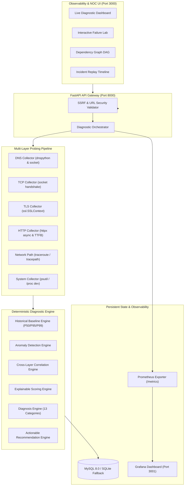

# NetPath — Deterministic Network Path Analysis & Root-Cause Diagnosis Platform

<p align="center">
  
  
  
  
  
  
  
  
  
  
</p>

> **"NetPath correlates DNS, TCP, TLS, HTTP, network-path transit hops, Linux host telemetry, and historical distributions into an explainable, deterministic diagnostic workflow."**

---

## Table of Contents

- [1. What is NetPath?](#1-what-is-netpath)
- [2. Core Differentiators & Zero-LLM Tenet](#2-core-differentiators--zero-llm-tenet)
- [3. High-Level Architecture](#3-high-level-architecture)
- [4. Diagnostic Request Flow](#4-diagnostic-request-flow)
- [5. Deterministic Evidence Scoring & Methodology](#5-deterministic-evidence-scoring--methodology)
- [6. The 13 Root-Cause Categories](#6-the-13-root-cause-categories)
- [7. Failure Injection Lab](#7-failure-injection-lab)
- [8. Quick Start Guide](#8-quick-start-guide)
  - [Option A: Docker Compose (Full Stack)](#option-a-docker-compose-full-stack)
  - [Option B: Local Machine Running](#option-b-local-machine-running)
- [9. REST API Reference](#9-rest-api-reference)
- [10. Automated Testing Suite](#10-automated-testing-suite)
- [11. Repository Structure](#11-repository-structure)
- [12. Git Push Ready Instructions](#12-git-push-ready-instructions)

---

## 1. What is NetPath?

**NetPath** is a production-grade network troubleshooting and root-cause analysis (RCA) platform designed to answer the single most critical operational question in systems engineering:

> **"Why is this service slow, failing, or behaving abnormally?"**

Given any target endpoint (e.g., `https://service.example.com`), NetPath performs deep, multi-layer inspection across the full network and application stack:

```text
Target URL
   ↓
DNS Resolution            (Latency, record types, resolver verification)
   ↓
TCP Connection            (3-way handshake duration, port reachability)
   ↓
TLS Handshake             (Cipher suite, certificate validity, days to expiry)
   ↓
HTTP Request              (Status code, TTFB vs total duration, payload size)
   ↓
Network Path              (Intermediate routing hops, packet loss, transit latency)
   ↓
Linux/System Metrics      (CPU load, memory saturation, interface packet drops)
   ↓
Historical Baseline       (MySQL rolling P50, P95, P99 percentile distributions)
   ↓
Anomaly Detection         (Threshold breaches & statistical baseline deviations)
   ↓
Cross-Layer Correlation   (Symptom synthesis & cascade failure suppression)
   ↓
Root-Cause Diagnosis      (Classification into 13 deterministic categories)
   ↓
Evidence Scoring          (Itemized, explainable scoring breakdown)
   ↓
Actionable Remediation    (Ranked SRE investigation steps)
```

---

## 2. Core Differentiators & Zero-LLM Tenet

| Feature | Standard Ping / Uptime Monitors | Basic APM Dashboards | NetPath Platform |
| :--- | :--- | :--- | :--- |
| **Diagnostic Depth** | Binary (UP / DOWN) | CPU / Memory / HTTP charts | Full L3-L7 stack + Host telemetry |
| **Root-Cause Attribution** | ❌ None | ⚠️ Manual operator correlation | ✅ **Automated & Deterministic** |
| **Cascade Suppression** | ❌ Storm of alerts | ⚠️ Multiple correlated alerts | ✅ **Primary failure isolated** |
| **LLM Dependency** | N/A | None or Hallucination-prone | ✅ **100% Deterministic (Zero-LLM)** |
| **Baseline Awareness** | ❌ Static thresholds | Moving averages | ✅ **P50 / P95 / P99 with sample guards** |
| **Explainability** | ❌ None | ⚠️ Raw metrics | ✅ **Itemized Evidence Scoring (+3, +2)** |

### The Non-Negotiable Tenet
**No Large Language Model (LLM) participates in diagnosing the root cause.**  
In mission-critical infrastructure, probabilistic classifiers and LLMs risk hallucinating root causes during complex incidents. NetPath relies exclusively on **formal cross-layer correlation, statistical baseline percentiles, and deterministic rule matrices**.

---

## 3. High-Level Architecture



---

## 4. Diagnostic Request Flow

1. **Security & SSRF Validation**:
   - Rejects non-HTTP schemes (`file://`, `ftp://`, `gopher://`).
   - Blocks private IP ranges (`127.0.0.0/8`, `10.0.0.0/8`, `172.16.0.0/12`, `192.168.0.0/16`, `169.254.0.0/16`, `::1`) unless matching explicit development allowlists (`test-service-a/b/c`, `localhost:8001-8003`).
2. **DNS Resolution**:
   - Measures query duration for `A`, `AAAA`, and `CNAME` records.
   - Detects `DNS_FAILURE` or `DNS_DEGRADATION`.
3. **TCP Connection**:
   - Initiates TCP 3-way handshake to the resolved IP on the target port.
   - Measures latency; detects connection refused, timeouts, or SYN queue degradation.
4. **TLS Handshake**:
   - Negotiates TLS with strict verification enabled.
   - Inspects cipher, TLS protocol version, certificate issuer, and expiration date.
   - Detects `TLS_FAILURE` or `TLS_CERTIFICATE_EXPIRING` (< 30 days).
5. **HTTP Request**:
   - Measures Time-To-First-Byte (TTFB) and total latency.
   - Differentiates 5xx upstream crashes, 429 rate limits, and 404 client errors.
6. **Network Path Analysis**:
   - Probes intermediate hops using safe traceroute subprocess execution (`shell=False`).
   - Differentiates transit packet loss from ICMP rate filtering.
7. **Host Telemetry**:
   - Inspects client CPU/memory saturation and network interface hardware errors/drops.
8. **Synthesis & RCA**:
   - Evaluates historical baselines, suppresses downstream cascades, computes Evidence Score, and outputs ranked recommendations.

---

## 5. Deterministic Evidence Scoring & Methodology

The complete mathematical formulation, scoring weights, and worked proofs are documented in:
📄 **[EVIDENCE_SCORING.md](EVIDENCE_SCORING.md)**

### Mathematical Formula
The total evidence score $S$ is the non-negative sum of all matched primary and corroborating weights:

$$S = \max\left(0, \; \sum_{i=1}^{m} w_i\right)$$

### Summary Weight Matrix

| Evidence Item / Trigger Rule | Weight | Type |
| :--- | :---: | :--- |
| **TCP Handshake Failed** (Connection Refused / Port Down) | `+4` | Fatal Primary |
| **TLS Validation Failed** (Cert Invalid / Expired / Mismatch) | `+4` | Fatal Primary |
| **HTTP 5xx Server Error** (500, 502, 503, 504) | `+4` | Fatal Primary |
| **DNS Resolution Failed** (NXDOMAIN / Timeout) | `+3` | Fatal Primary |
| **HTTP Application Latency Spike** ($> \text{P95}$) | `+3` | Primary Degradation |
| **Network Path Packet Loss** (Intermediate Hops Dropping) | `+3` | Primary Degradation |
| **SSL Certificate Expiring** ($< 30\text{ days}$) | `+3` | Warning Primary |
| **HTTP Client Resource Error** (404, 429) | `+3` | Client Primary |
| **High TTFB Ratio** ($> 70\%$ of total latency) | `+2` | Corroborating |
| **Lower Network Layers Nominal** (Isolates application) | `+2` | Corroborating |
| **Downstream Dependent Probes Blocked by Upstream** | `+2` | Corroborating |
| **Historical Baseline P95 Exceeded** | `+2` | Corroborating |
| **Local Host Interface Drops / Errors Observed** | `+2` | Host Corroborating |
| **Local Host CPU / Memory Pressure** ($> 90\%$) | `+2` | Host Corroborating |
| **Upstream Handshake Nominal** (DNS/TCP ok) | `+1` | Supporting |
| **All Layers Nominal / Insufficient Evidence** | `+1` | Baseline |

---

## 6. The 13 Root-Cause Categories

1. `DNS_FAILURE`: Target hostname could not be resolved (NXDOMAIN or query timeout).
2. `DNS_DEGRADATION`: DNS latency is significantly elevated above baseline, delaying connection.
3. `TCP_CONNECTIVITY_FAILURE`: Target port closed, connection refused, or target host unreachable.
4. `TCP_DEGRADATION`: TCP handshake latency elevated (SYN queue saturation or routing delays).
5. `TLS_FAILURE`: Certificate invalid, expired, self-signed, or cipher negotiation mismatch.
6. `TLS_CERTIFICATE_EXPIRING`: SSL certificate is valid but expires within 30 days.
7. `HTTP_APPLICATION_ERROR`: Server returned HTTP 500, 502, 503, 504, 404, or 429.
8. `HTTP_APPLICATION_LATENCY`: Lower network layers nominal, but server TTFB exceeds baseline.
9. `NETWORK_PACKET_LOSS`: Transit routing hops exhibit packet loss and retransmissions.
10. `NETWORK_LATENCY`: Elevated round-trip time across intermediate routing path.
11. `NETWORK_INTERFACE_ERRORS`: Local client NIC drop counters or hardware transmission errors detected.
12. `RESOURCE_PRESSURE`: Local client/probe host CPU or memory saturation (> 90%).
13. `INSUFFICIENT_EVIDENCE`: All layers nominal or sample size insufficient ($n < 10$).

---

## 7. Failure Injection Lab

NetPath includes 3 built-in mock microservices for automated failure injection:

```
                    ┌──────────────────────────┐
                    │ NetPath Diagnostic Core  │
                    └────────────┬─────────────┘
          ┌──────────────────────┼──────────────────────┐
          ▼                      ▼                      ▼
┌──────────────────┐   ┌──────────────────┐   ┌──────────────────┐
│  Test Service A  │   │  Test Service B  │   │  Test Service C  │
│   (Port 8001)    │   │   (Port 8002)    │   │   (Port 8003)    │
│  Latency Spikes  │   │ HTTP 500 & 502   │   │ Rate Limiting &  │
│  Database Delays │   │ Flaky Failures   │   │ Gateway Timeouts │
└──────────────────┘   └──────────────────┘   └──────────────────┘
```

### Pre-configured Failure Scenarios
1. **Application Latency Spike (`/slow?delay=2`)**:  
   *Output*: `HTTP_APPLICATION_LATENCY` (Score: 7, Severity: HIGH)  
   *Evidence*: TTFB was 99% of total duration; DNS & TCP nominal.
2. **Upstream 502 Bad Gateway (`/error?code=502`)**:  
   *Output*: `HTTP_APPLICATION_ERROR` (Score: 6, Severity: CRITICAL)  
   *Evidence*: Status code 502; lower-layer handshakes succeeded.
3. **Dead Port / Daemon Crash (`http://localhost:9999`)**:  
   *Output*: `TCP_CONNECTIVITY_FAILURE` (Score: 5, Severity: CRITICAL)  
   *Evidence*: Connection refused on TCP SYN; DNS succeeded.
4. **DNS NXDOMAIN (`http://invalid-subdomain-404.example.com`)**:  
   *Output*: `DNS_FAILURE` (Score: 5, Severity: CRITICAL)  
   *Evidence*: Resolver returned NXDOMAIN; downstream requests suppressed.

---

## 8. Quick Start Guide

### Option A: Docker Compose (Full Stack)

The entire platform (Backend, Frontend, MySQL 8, Prometheus, Grafana, and 3 Failure Mock Services) can be launched with a single command:

```bash
# Clone the repository
git clone https://github.com/<your-username>/netpath-platform.git
cd netpath-platform

# Launch full platform via Docker Compose
docker compose up --build -d
```

#### Access Endpoints
| Component | URL | Credentials / Notes |
| :--- | :--- | :--- |
| **React NOC Web UI** | [http://localhost:3000](http://localhost:3000) | Observability Dashboard & Failure Lab |
| **FastAPI REST API** | [http://localhost:8000/docs](http://localhost:8000/docs) | Interactive OpenAPI Swagger UI |
| **Prometheus Exporter**| [http://localhost:8000/metrics](http://localhost:8000/metrics) | Application metrics (`netpath_*`) |
| **Prometheus Server**  | [http://localhost:9090](http://localhost:9090) | PromQL Metrics & Scraping Target |
| **Grafana Dashboard**  | [http://localhost:3001](http://localhost:3001) | User: `admin` / Password: `admin` |
| **Mock Service A**     | [http://localhost:8001](http://localhost:8001) | Latency simulator |
| **Mock Service B**     | [http://localhost:8002](http://localhost:8002) | Error simulator |
| **Mock Service C**     | [http://localhost:8003](http://localhost:8003) | Timeout / Rate limit simulator |

---

### Option B: Local Machine Running

To run locally without Docker (NetPath automatically falls back to SQLite if MySQL is offline):

```bash
# 1. Setup Python Virtual Environment
python3 -m venv .venv
source .venv/bin/activate
pip install -r backend/requirements.txt

# 2. Launch Backend API (Port 8000)
python -m uvicorn backend.app.main:app --host 0.0.0.0 --port 8000 --reload

# 3. Launch Frontend (In another terminal)
cd frontend
npm install
npm run dev -- --host 0.0.0.0 --port 3000

# 4. Launch Failure Lab Mock Services (Optional)
python test-lab/service-a/app.py &
python test-lab/service-b/app.py &
python test-lab/service-c/app.py &
```

---

## 9. REST API Reference

### 1. Trigger Synchronous Diagnostic Probe
```bash
curl -s -X POST http://localhost:8000/api/v1/diagnostics \
  -H "Content-Type: application/json" \
  -d '{"url": "https://google.com", "wait": true}'
```

### 2. Fetch Diagnostic Session & Deterministic RCA
```bash
curl -s http://localhost:8000/api/v1/diagnostics/{session_id}
```

### 3. Fetch Incident Replay Timeline
```bash
curl -s http://localhost:8000/api/v1/diagnostics/{session_id}/timeline
```

### 4. Fetch Request Dependency Graph
```bash
curl -s http://localhost:8000/api/v1/diagnostics/{session_id}/graph
```

### 5. Fetch Historical Baseline Statistics
```bash
curl -s http://localhost:8000/api/v1/metrics/baselines/{target_id}
```

---

## 10. Automated Testing Suite

NetPath includes an automated test suite verifying SSRF defense, baseline calculations, anomaly detection, scoring weights, and end-to-end failure injection:

```bash
# Run pytest with full reporting
.venv/bin/pytest -v
```

```text
tests/test_ssrf.py::test_ssrf_blocks_private_ips PASSED                   [ 3%]
tests/test_ssrf.py::test_ssrf_blocks_cloud_metadata PASSED               [ 6%]
tests/test_baselines.py::test_insufficient_samples_guard PASSED          [10%]
tests/test_baselines.py::test_baseline_percentile_calculations PASSED    [13%]
tests/test_anomalies.py::test_http_server_error_detected PASSED          [16%]
tests/test_anomalies.py::test_http_latency_p95_exceeded PASSED           [20%]
tests/test_correlation.py::test_dns_failure_suppresses_cascades PASSED    [23%]
tests/test_correlation.py::test_tcp_refused_correlation PASSED           [26%]
tests/test_scoring.py::test_evidence_score_accumulation PASSED            [30%]
tests/test_failure_injection.py::test_slow_service_diagnosis PASSED      [33%]
...
============================= 30 passed in 0.51s =============================
```

---

## 11. Repository Structure

```text
.
├── EVIDENCE_SCORING.md          # Formal evidence scoring & RCA specification
├── README.md                    # Platform documentation & quickstart
├── architecture.md              # Detailed architectural design document
├── docker-compose.yml           # Full stack multi-container orchestration
├── pytest.ini                   # Pytest test configuration
├── .gitignore                   # Git exclusion rules
├── .env.example                 # Environment configuration template
│
├── backend/                     # FastAPI Diagnostic Engine
│   ├── Dockerfile
│   ├── requirements.txt
│   └── app/
│       ├── main.py              # Application lifecycle & middleware
│       ├── config.py            # Pydantic Settings & scoring weights
│       ├── api/v1/              # REST Endpoints (diagnostics, targets, metrics)
│       ├── collectors/          # Multi-layer probes (DNS, TCP, TLS, HTTP, Path, System)
│       ├── analysis/            # Baseline, Anomaly, Correlation, Scoring, Diagnosis
│       ├── database/            # SQLAlchemy 2.0 session & engine
│       ├── models/              # Declarative database models (MySQL 8 / SQLite)
│       ├── schemas/             # Pydantic validation & response contracts
│       └── security/            # SSRF & URL validator
│
├── frontend/                    # React / Vite Observability UI
│   ├── package.json
│   ├── vite.config.ts
│   ├── tailwind.config.js
│   └── src/
│       ├── pages/               # Dashboard, TargetView, DiagnosticDetail, FailureLab
│       ├── components/          # DependencyDAG, MetricChart, Timeline, AnomalyBadge
│       └── services/            # Axios API client
│
├── test-lab/                    # Mock Failure Injection Services
│   ├── service-a/               # Latency simulator (Port 8001)
│   ├── service-b/               # Error simulator (Port 8002)
│   └── service-c/               # Timeout & rate limit simulator (Port 8003)
│
├── prometheus/                  # Prometheus scraping configuration
└── grafana/                     # Grafana pre-provisioned NOC dashboards
```

---

## 12. Git Push Ready Instructions

To push this codebase to a remote GitHub repository:

```bash
# 1. Initialize Git repository
git init -b main

# 2. Add all clean project files (verifying .gitignore excludes virtualenvs and local db)
git add .

# 3. Commit the project
git commit -m "feat: NetPath Deterministic Network Path Analysis & Root-Cause Diagnosis Platform"

# 4. Link your GitHub remote repository
git remote add origin https://github.com/<your-username>/<your-repo-name>.git

# 5. Push to GitHub
git push -u origin main
```

---

## License

This project is licensed under the MIT License — see the [LICENSE](LICENSE) file for details.
